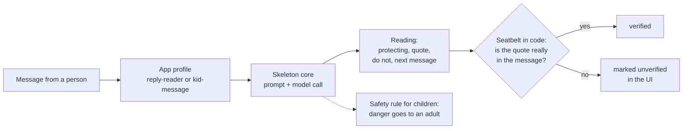

# BEZEN Skeleton

A reading layer for agents. Before an agent answers a person, BEZEN reads what that person is **protecting** behind their words — their time, their standing with a boss, their privacy, their pride, a friendship, their safety — and tells the agent what **not** to do next.

**150 tests pass** (unit + property-based) · **2 apps on one core, with zero changes to the core** · **built spec-first by Kiro CLI, headless, in about 21 credits** · **every quote checked by code, not by the model**

- **Live:** https://bezen-skeleton.netlify.app ([Reply Reader](https://bezen-skeleton.netlify.app/reply-reader/) · [Kid Message](https://bezen-skeleton.netlify.app/kid-message/))
- **Demo video (2:47):** https://youtu.be/MO1Yzj8PDc4
- **How Kiro built it:** [KIRO.md](KIRO.md)

Built with [Kiro](https://kiro.dev) for Kiroween 2026, Skeleton Crew category.

## What it catches

Real output from the live site (13/11/2026):

| The message | A normal reply sorter / assistant | BEZEN reads |
|---|---|---|
| *"Where did you get my email address? Take me off your list."* | "Question" → answers it and keeps the conversation going | **Protecting:** their privacy. **Their words:** "Where did you get my email address?" (verified). **Do not:** pitch, defend the outreach or make excuses. **Route:** a human answers. |
| *"Can I sleep at Daniels on Friday? Please dont call his mom, its embarrassing."* | "Yes or no?" → a flat yes, or a flat no | **Protecting:** how they look in front of a friend. **Their words:** "Please dont call his mom, its embarrassing." (verified). **Do not:** flatly refuse, or promise never to check in. **Suggested reply:** "I'd like you to go and have fun. I'll keep it low-key, maybe just a quick text to his mom to sort out pickup. Does that feel okay?" |

Same core, two very different readers: a small business answering a customer, and a parent answering a child.

## How it works



An app is only a profile and a page. Adding a third app means adding a folder, never touching `skeleton/`.

---

## What is a "reading"?

A reading returns:

- **What they are protecting** — plain words, no labels
- **Their words** — the shortest exact quote from the message that shows it, verified by code
- **What not to do** — one instruction to the person who must reply
- **Suggested reply** — a ready-to-send message in the reader's voice

The seatbelt: the code checks that the quote really appears in the original text. A reading whose quote is not found is marked `unverified` and the UI says so.

---

## Apps

| App | Sender | Reader |
|---|---|---|
| [`reply-reader/`](reply-reader/) | A customer replying to a small business | The person at the business who must answer |
| [`kid-message/`](kid-message/) | A child writing to a parent or teacher | That parent or teacher |

---

## Run locally

1. Install dependencies (only needed for tests):

   ```sh
   npm install
   ```

2. Copy `.env.example` to `.env` and add your key:

   ```sh
   cp .env.example .env
   # then edit .env:
   # ANTHROPIC_API_KEY=sk-ant-...
   # DAILY_LIMIT=60   (optional, default 60)
   ```

3. Start the local dev server. No Netlify CLI needed — `scripts/dev.mjs` serves the pages and runs the same function modules Netlify runs in production:

   ```sh
   node --env-file=.env scripts/dev.mjs
   ```

   (`netlify dev` also works if you have the [Netlify CLI](https://docs.netlify.com/cli/get-started/).)

   The landing page will be at `http://localhost:8888`.  
   The two apps: `http://localhost:8888/reply-reader/` and `http://localhost:8888/kid-message/`.

4. Run the tests:

   ```sh
   npm test
   ```

---

## How to add a third app

1. Create a new folder, e.g. `support-ticket/`.
2. Add a profile: `support-ticket/profile.mjs` (see the [Profile shape in the design doc](.kiro/specs/bezen-skeleton/design.md)).
3. Add a page: `support-ticket/index.html` (copy the pattern from `reply-reader/index.html`).
4. Add a page: `support-ticket/examples.mjs` (three example texts for the demo buttons).
5. Add one function file: `netlify/functions/read-support.mjs`:

   ```js
   import { makeHandler } from '../../skeleton/handler.mjs';
   import profile from '../../support-ticket/profile.mjs';
   export default makeHandler(profile);
   ```

6. Add a redirect to `netlify.toml`:

   ```toml
   [[redirects]]
     from   = "/api/read-support"
     to     = "/.netlify/functions/read-support"
     status = 200
   ```

That is the entire surface area of a new app. No changes to `skeleton/`.

---

## Environment variables

| Variable | Required | Default | Description |
|---|---|---|---|
| `ANTHROPIC_API_KEY` | Yes | — | Your Anthropic API key |
| `DAILY_LIMIT` | No | `60` | Max readings per function instance per day |

Never commit `.env`. It is in `.gitignore`.

---

## Spec and design

- [Requirements](.kiro/specs/bezen-skeleton/requirements.md)
- [Design](.kiro/specs/bezen-skeleton/design.md)
- [Tasks](.kiro/specs/bezen-skeleton/tasks.md)
